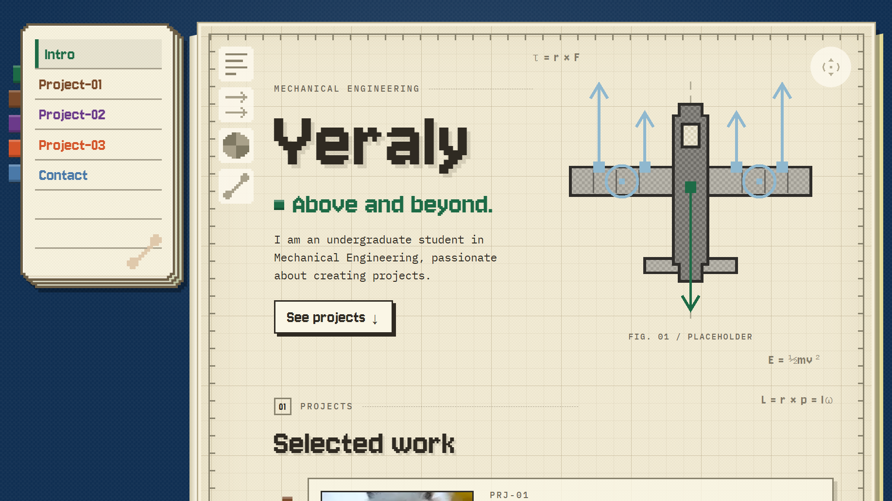
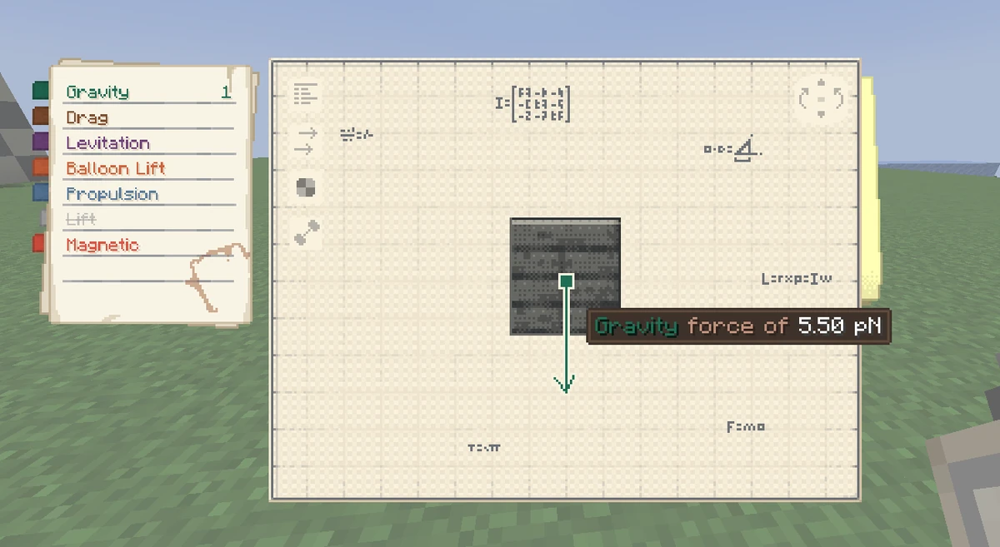

# website

Personal engineering portfolio, styled like a *contraption diagram* from Create Aeronautics: a paper menu and a big blueprint sheet lying on a table.

> *Above and beyond.*

## Screenshots and references

### Homepage



### Visual references

| Contraption diagram | Contraption diagram: weight |
|---|---|
|  |  |

| Contraption diagram 2 | Airship and balloon schematics |
|---|---|
|  |  |

The reference images document the visual direction for the paper menu, colored tabs,
blueprint layout, force diagrams, and handwritten technical annotations. They are
kept separate from the site's own preview image.

## Info

| | |
|---|---|
| Domain | [just-create.tech](https://just-create.tech) |
| Nickname | JustCreate |
| Full name | Yeraly |
| Email | Email@gmail.com |
| GitHub | [github.com/Yera1y](https://github.com/Yera1y) |
| Quote | Above and beyond |

## Concept

- The page is a **table** (deep blue background) with two sheets on it.
- **Left:** a stack of paper sheets with straight, pixel-stepped edges. The top sheet is the menu. The sheets under it change count and tint on every page, and the top sheet is dealt in with a short animation when you change page.
- **Right:** a big blueprint sheet with a grid, tick marks, rolled edges and small margin formulas.
- Force arrows and hover tooltips (like "Gravity force of 5.50 N") connect the diagram idea to the content. The three project blocks hang on one green arrow, like parts of a contraption.

### Navigation (two layers)

| Element | What it does |
|---|---|
| Colored bookmarks (behind the paper) | Go to another **page**. The bookmark of the current page is tucked inward and made shorter. |
| Text lines on the paper | Jump to a **section of the current page**. The line for the section in view is highlighted. |
| First tool button (top-left of the blueprint sheet) | **Shows or hides the whole menu**, for a full-width page. The choice is remembered between pages. |

Bookmarks: Home (green), Project 01 (brown), Project 02 (purple), Project 03 (orange), Contact (blue).

The other three tool buttons (arrows, shaded circle, bone) are pixel-art placeholders with no function yet.
Page changes use a smooth paper transition, and the menu toggle smoothly slides the
navigation away while the blueprint expands into the released space.

## Page layout

**Left side:** persistent paper-list menu, on every page.

**Homepage** (`index.html`)
1. Name, the line "Above and beyond." and a short introduction, next to a blueprint of an aircraft
2. Three project blocks, stacked vertically
3. Contact

Paper lines: Intro, Projects, Contact.

**Project pages** (`project-01.html`, `project-02.html`, `project-03.html`)
1. Technical project heading
2. Information
3. Photos
4. Research
5. Results

Paper lines: Heading, Information, Photos, Research, Results. Same paper menu and bookmarks as the homepage.

## Structure

```
website/
├── index.html          homepage
├── project-01.html     project page template (02 and 03 are copies)
├── project-02.html
├── project-03.html
├── style.css           all styling
├── site.js             tooltips, current-section highlight, menu toggle, page-change animation
├── fonts/              self-hosted fonts (no Google Fonts, works in China)
├── assets/reference/   visual reference images
└── docs/preview.png   homepage screenshot for this README
```

## Credits

- Visual style inspired by the contraption diagram of the Create Aeronautics mod for Minecraft. This is a fan-style homage. No game assets are used, and the project is not affiliated with the mod or its authors.
- Fonts: [Jersey 10](https://fonts.google.com/specimen/Jersey+10) and [IBM Plex Mono](https://github.com/IBM/plex), both under the SIL Open Font License.
