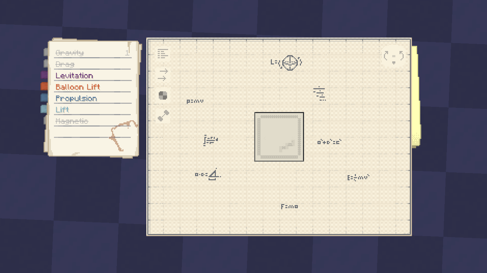
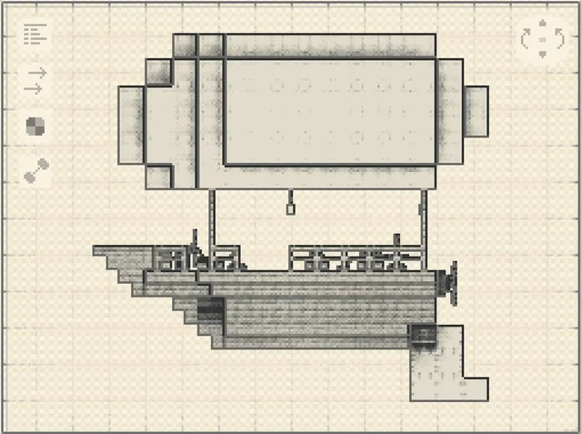

# website

Personal engineering portfolio, styled like a *contraption diagram* from Create Aeronautics: a paper menu and a big blueprint sheet lying on a table.

> *[just-create.tech](https://just-create.tech)*

## Screenshots and references

### Homepage


### Visual references: captured in game

| Contraption diagram | Contraption diagram: weight |
|---|---|
|  |  |

| Contraption diagram 2 | Airship and balloon schematics |
|---|---|
|  |  |

The reference images document the visual direction for the paper menu, colored tabs,
blueprint layout, force diagrams, and handwritten technical annotations. They are
kept separate from the site's own preview image.

## Navigation

| Element | What it does |
|---|---|
| Colored bookmarks | Go to another **page**. The bookmark of the current page are made shorter. |
| Text lines on the paper | Jump to a **section on current page**. The line for the section in view is highlighted. |
| tool button | **Shows or hides the whole menu** |

The other three tool buttons are placeholders with no function yet.

## Structure

```
website/
├── content/            the text of every page, one JSON file per page
│   ├── home.json
│   └── project-01.json (02, 03, ...)
├── templates/          the markup: base.html (shared shell), home.html, project.html
├── build.py            generates the .html files below (Python 3, no installs)
├── index.html          GENERATED homepage
├── project-01.html     GENERATED project pages (02, 03, ...)
├── style.css           all styling
├── site.js             tooltips, current-section highlight, menu toggle, page-change animation
├── fonts/              self-hosted fonts (no Google Fonts, works in China)
├── assets/project-01/  photos for each project (02, 03, ...)
├── assets/reference/   visual reference images
└── docs/preview.png   homepage screenshot for this README
```

## Credits

- Visual style inspired by the contraption diagram of the Create Aeronautics mod for Minecraft.
- Fonts: [Jersey 10](https://fonts.google.com/specimen/Jersey+10) and [IBM Plex Mono](https://github.com/IBM/plex).
